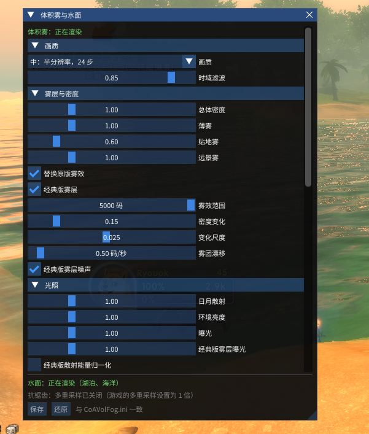

# 🌌 Ascension：征服艾泽拉斯超高清补丁包

**简体中文** | [English](README.en.md)

这是一套面向 **Ascension：征服艾泽拉斯（Conquest of Azeroth）** 的超高清画面与音效整合包，提供更新的生物模型、高分辨率贴图、增强的法术特效，以及环境、照明、水面与着色器等改进。

整合包附带**定制 64 位客户端**、**LuxVelum** 和作者自用的 **ReShade 预设**。

  
  
  

  
  

---

## ⚠️ 兼容性说明

**完整支持仅限 Conquest of Azeroth Core。**

Conquest Reborn、ArdenWoW、Grimfall 等自定义 3.3.5a 服务器可能检测到修改过的客户端，并阻止 64 位客户端运行。按兼容指南调整后，仍可尝试使用这些增强内容。

[高清补丁兼容与重命名指南（简体中文）](Compatibility%20Guide.md)

标准 3.3.5a 或 1.12 客户端可参考 [Project Reforged](https://projectreforged.github.io/)。

## 🧩 补丁清单

| 文件 | 内容 |
| --- | --- |
| `patch-AAP.MPQ` | 增强法术粒子特效 |
| `patch-AAS.MPQ` | 升级音效与音乐 |
| `patch-ZZA.MPQ` | 增强着色器与字体 |
| `patch-ZZB.MPQ` | 高清建筑与结构 |
| `patch-ZZD.MPQ` | 高清场景杂物与世界物件 |
| `patch-ZZE.MPQ` | 高清环境与地形 |
| `patch-ZZU.MPQ` | 直背兽人模型 |
| `patch-ZZY.MPQ` | 正式服风格鼠标指针 |
| `patch-ZZZ.MPQ` | 增强溅血效果 |

完整 CoA 方案中的 `patch-ZZB`、`patch-ZZD` 和 `patch-ZZE` 如需使用，须一起保留。其他补丁可按需移除。ArdenWoW 等服务器请按兼容指南调整。

## 🖼️ 附加内容

- **64 位征服艾泽拉斯客户端**：整合包包含定制的 64 位客户端，作者称其性能明显优于原有的 32 位客户端。完整 CoA 方案需要使用它。
- **LuxVelum**：增强雾气、光照和水面。在游戏中按 **Ctrl+F7** 打开设置。
  - **ArdenWoW 简体中文光影方案**：本仓库维护者汉化的 32 位 **CoAVolFog** 已在 ArdenWoW 中实测可用，可用 **Ctrl+F7** 打开中文设置，调整体积雾、光照和动态水面。它可作为 ArdenWoW 上的光影选项。两者都使用游戏目录下的 `version.dll`，请选择一套安装。[CoAVolFog 简体中文版与安装说明](https://github.com/moshoutegong/coa-vfog-CN)

    游戏内按 **Ctrl+F7** 打开的 CoAVolFog 简体中文设置界面。

    
- **自定义 ReShade 预设**：改善清晰度、对比度和色彩。在游戏中按 **Home** 打开设置。
- **自定义 `Config.wtf`**：进一步提高视距、环境细节、阴影与特效。

> [!IMPORTANT]
> 打开 `Config.wtf`，按需调整分辨率、刷新率和界面缩放。作者建议在这个文件里修改画质设置。在游戏内修改画质可能会把帧率上限重置为 15 FPS，遇到这种情况请重新调整。请保持视频设置中的**镜面光照（Specular Lighting）**开启。

### 附带插件

| 插件 | 用途 |
| --- | --- |
| Bloody Screen | 打出暴击时显示屏幕溅血效果 |
| Music While You Dancing | 跳舞时播放音乐 |
| Leatrix Plus | 自动修理、快速拾取等便利功能 |
| Enhanced Battleground Scoreboard | 在战场计分板上显示 CoA 职业 |
| CoaTooltip | 在提示框中显示玩家专精、装备等级和 PvE 强度 |

## 📥 下载与安装

[下载整合包（Google Drive）](https://drive.google.com/file/d/1i5adZD5hBE9FBuUIZ3Wv884P8sBE15-8/view?usp=drivesdk)

以下是完整 **CoA Core** 方案。ArdenWoW 玩家请使用[兼容指南](Compatibility%20Guide.md)。

1. 下载并解压整合包。
2. 将包内文件放入征服艾泽拉斯客户端目录。
3. 运行 `CoA64.exe` 启动游戏。

遇到 Google Drive 下载配额限制

作者建议先把文件添加为自己云端硬盘中的快捷方式，新建一个文件夹并把快捷方式移进去，再将该文件夹整体下载为 ZIP。直接下载受限时，可以尝试这个方法。

### 安装 ReShade（CoA Core 方案）

1. 下载并运行 [ReShade 6.8.0 Addon 安装器](https://reshade.me/downloads/ReShade_Setup_6.8.0_Addon.exe)。
2. 将 `CoA64.exe` 选为目标程序。
3. 图形 API 选择 **Vulkan**。
4. 选择 **Update ReShade Only**（仅更新 ReShade）完成安装。

首次启动前，请在 `Config.wtf` 中按自己的显示器调整分辨率、刷新率和界面缩放。

## 💬 支持

遇到问题可查看[常见问题与故障排查](https://github.com/fueryin/Conquest-of-Azeroth-Ultra-HD-Graphics-Modpack/issues?q=is%3Aissue+state%3Aclosed)，或在 Discord 联系原作者 **akuru_001**。

本页根据 [fueryin 的英文原文](https://github.com/fueryin/Conquest-of-Azeroth-Ultra-HD-Graphics-Modpack/blob/CoA-HD-PATCH/README.md) 翻译。
